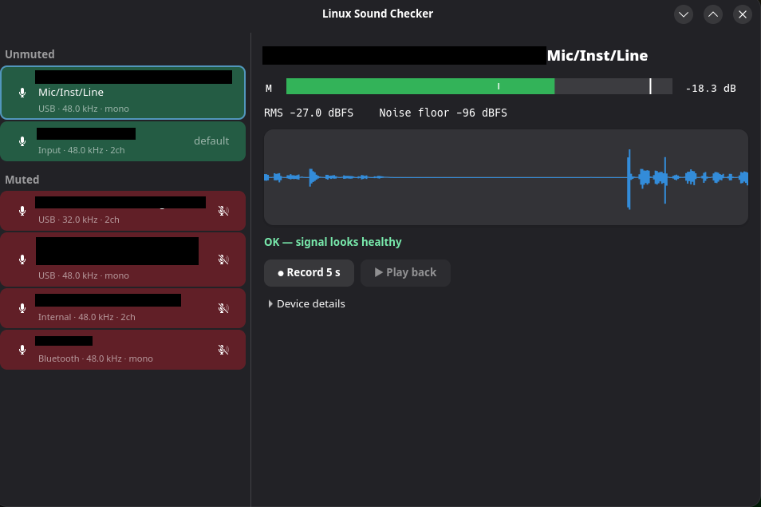

# Linux Sound Checker

A small native Linux desktop app for testing microphones and other audio inputs:
detect connected devices, see their levels live, spot common problems, and hear
what the mic actually captures.

Targets: Arch Linux and Fedora, desktop-environment agnostic, PipeWire or PulseAudio.
Open tasks are in [TODO.md](TODO.md).



## Features

| Feature                 | Behaviour                                                                 |
| ----------------------- | ------------------------------------------------------------------------- |
| Tabs                    | "Recording" tab lists inputs, "Sound" tab lists outputs; the right pane follows the open tab |
| Device discovery        | List input sources (monitor sources hidden) and outputs, one per tab |
| Categories              | Recording: Unmuted / Muted / "No microphone" (A2DP-only Bluetooth) / Disabled. Sound: Unmuted / Muted / Disabled |
| Activity colouring      | Unmuted inputs picking up sound turn green and fade out over 3 s; idle ones are dimmed; muted ones are red. Outputs: green while playing, dimmed when idle, red when muted |
| Hot-plug                | Refresh on Pulse subscribe events (source/card add, remove, change)       |
| Mute & volume           | Mute button on every input and output (list row and details pane); reset volume to 100% |
| Default device          | "Set as default" for any input or output (the current one is tagged "default") |
| Rename                  | "Rename…" gives a device a custom name, shown only in this app (`~/.config/sound-checker/names.json`, keyed by node name); Reset restores the original |
| Per-channel meters      | Peak and RMS in dBFS for each channel, with peak hold                     |
| Waveform                | Scrolling waveform of the selected input or output                        |
| Diagnostics             | Silence, clipping, dead/imbalanced channel, disconnect, capture errors    |
| Noise floor             | Quietest RMS window over the last 10 s                                    |
| Record & play back      | Record 5 s from the selected input or output, play it through the default output |
| Bluetooth profile hint  | Detect a BT card in A2DP with an available HFP/HSP profile; offer to switch |
| System-wide disable     | PipeWire only: block one input or output for every app via a WirePlumber `node.disabled` rule (state in `~/.config/sound-checker/disabled.json`); re-enable from the "Disabled" list (under Inputs or Outputs). Restarts WirePlumber (brief audio interruption); afterwards the app restores the default devices, moves streams back to the devices they were on, puts cards back on their previous profile and reconnects Bluetooth devices (what it changed is logged to `~/.config/sound-checker/restart.log`). Bluetooth headsets get "Switch to music mode (no mic)" instead, and Bluetooth devices have no disable button. Not hardware-level: direct ALSA access still works |
| Device details          | Sample rate, format, channel map, driver, card/bus info                   |
| Live monitoring         | Every unmuted input and every output (via its monitor source) is metered continuously; selecting a device just shows its meters, waveform and recording. Captures don't keep sleeping devices awake. Muted inputs show "Muted" and an empty meter (the server mutes before the app can see the signal) |

## UI sketch

```
┌ Linux Sound Checker ── [ Sound | Recording ] ────────────────┐
│ Unmuted                       │ Live analysis                │
│ ▌Built-in Microphone  default │  L ████████████░░░░  -6.2 dB │
│ ▌USB Headset Microphone    🎤 │  R ███████████░░░░░  -7.0 dB │
│ Muted                         │  RMS -21.4 dBFS  Noise -62   │
│ ▌Webcam Mic (red)          🔇 │  ~~~~~ waveform ~~~~~        │
│ No microphone                 │  Status: OK / Clipping / ... │
│ BT Headset [Switch to headset]│  [● Record 5s] [▶ Play back] │
│ Disabled                      │  [Mute] [Rename…] [Disable…] │
│ ▌Old mic          [Enable]    │                              │
└───────────────────────────────┴──────────────────────────────┘
(the Sound tab lists outputs the same way; playing outputs are green)
```

## Design decisions

| Topic        | Choice                                                                 |
| ------------ | ---------------------------------------------------------------------- |
| Language     | Rust                                                                   |
| UI           | GTK4 + libadwaita                                                      |
| Audio API    | PulseAudio client API (`libpulse-binding` + `libpulse-glib-binding`)   |
| Distribution | Flatpak first; AUR PKGBUILD later; no RPM/COPR for the MVP             |

**Why the Pulse API:** Arch and Fedora both default to PipeWire, which serves the
Pulse protocol via `pipewire-pulse`. One backend covers both PipeWire and real
PulseAudio. `libpulse-glib-binding` runs Pulse on the GLib main loop, so server
events arrive on the GTK thread without extra plumbing.

The app connects to the user's existing audio server and never starts its own.

## Architecture

```
GTK main loop (UI thread)
├── src/pulse.rs    Pulse context (glib mainloop): sources, cards, profiles,
│                   mute/volume, subscribe events -> device model
├── src/capture.rs  Pulse record stream for the selected source -> analyzer;
│                   fixed-length recording and playback stream
├── src/activity.rs one tiny peak-detect stream per unmuted source, used for the
│                   green/grey row colouring (like pavucontrol's level bars)
├── src/analysis.rs per-block peak/RMS, clip/silence/dead-channel detection,
│                   waveform decimation (pure, unit-tested)
└── src/ui.rs       device list, meters, waveform; redraws from a
                    frame-synced tick callback
```

Analysis runs per audio block, outside the drawing path. The UI only reads the
latest summary and a decimated waveform; it never redraws per sample. Pulse
callbacks and the UI share one thread, so state is `Rc<RefCell<..>>` with no
locking (no ring buffer needed).

## Notes and limitations

- Activity colouring opens a capture stream on every unmuted input, which wakes
  suspended devices (a webcam LED may light up while the app is open).
- Muted inputs are not monitored: the audio server silences them before any
  client can see the signal, so they always show red.
- Row colours are CSS classes (`src-active`, `src-idle`, `src-muted`); the fade is
  a CSS transition, so a list rebuild (any device event) restarts it.

## Build

    cargo run --release
    cargo test

Dependencies — Arch: `rust gtk4 libadwaita libpulse pkgconf`;
Fedora: `rust cargo gtk4-devel libadwaita-devel pulseaudio-libs-devel pkgconf`.

## Flatpak

    flatpak-cargo-generator.py Cargo.lock -o packaging/cargo-sources.json
    flatpak-builder --user --install --force-clean build-dir packaging/dev.soundchecker.SoundChecker.yml

Needs `flatpak-builder`, `org.gnome.Platform`/`Sdk` and
`org.freedesktop.Sdk.Extension.rust-stable`. Uses `--socket=pulseaudio`.

## Testing matrix

The audio stack and hardware matter more than the desktop environment.

- PipeWire (`pipewire-pulse`) and real PulseAudio
- Built-in mic, USB headset/mic, webcam mic, Bluetooth headset (A2DP and HFP)
- Hot-plug while capturing (unplug the selected device)
- Muted/zero-volume source, mono and stereo sources, 44.1 vs 48 kHz
- Run as Flatpak and as a native build on both Arch and Fedora
